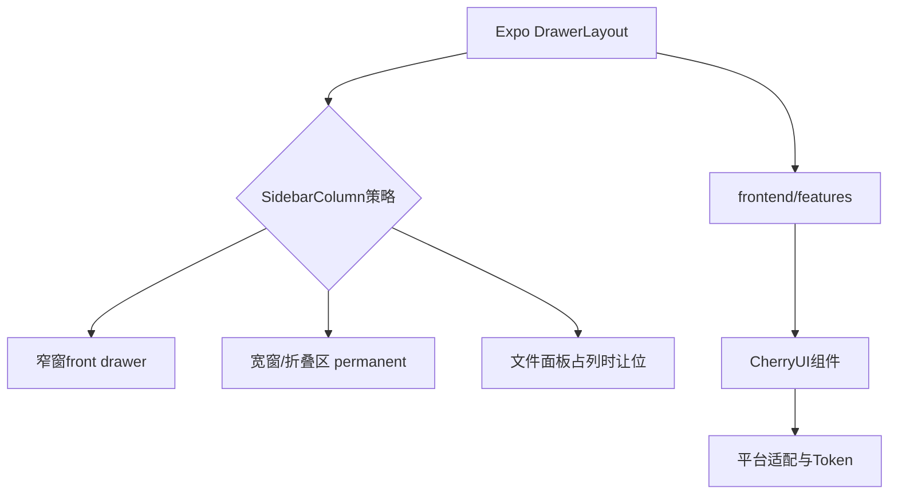

# layout

Expo Router的DrawerLayout实际承载Sidebar。窗口列策略分overlay/collapsed/yielded/permanent：窄窗overlay；文件面板占左列时yielded；折叠屏竖向分隔可按fold末端决定permanent宽；用户collapse在这些条件之后判断。不要把路由分组名或过时Token注释当作不存在Sidebar的证据。

overlay宽=min(400,windowWidth-64)，保留64点聊天条作为上下文和关闭入口；swipeActivationDistance20用来让表格/代码横向滚动先认领手势，swipe只在overlay且chatFocused启用。permanent与front切换保留内容树。

BottomSheet最大宽720；availableHeight=windowHeight-insets.top-12；compact/medium/large/full=.4/.6/.8/1。菜单首次测量panelHeight>0才播放，定位考虑safe area与空间。多档面板保留吸附高度，键盘压缩body。

全应用isWide阈值和FoldRegion平台检测仍需进一步建档，不把400或720推成全局断点。

## 来源与状态

source-verified：上面明确的实现事实。标为“分析”的解释为 inferred；未运行原项目。

- [`src/app/(drawer)/_layout.tsx:40` — `export default`](https://github.com/CherryHQ/cherry-studio-app/blob/e6d157d2ea604ef65d38ca14e88ba92de706ad8a/src/app/(drawer)/_layout.tsx#L40)
- [`src/frontend/appShell/sidebar/resolveSidebarColumn.ts:48` — `export function resolveSidebarColumn`](https://github.com/CherryHQ/cherry-studio-app/blob/e6d157d2ea604ef65d38ca14e88ba92de706ad8a/src/frontend/appShell/sidebar/resolveSidebarColumn.ts#L48)
- [`src/frontend/utils/constants.ts:58` — `export const appSidebar`](https://github.com/CherryHQ/cherry-studio-app/blob/e6d157d2ea604ef65d38ca14e88ba92de706ad8a/src/frontend/utils/constants.ts#L58)
- [`packages/ui/src/components/menu/menu-content.tsx:19` — `export function MenuContent`](https://github.com/CherryHQ/cherry-studio-app/blob/e6d157d2ea604ef65d38ca14e88ba92de706ad8a/packages/ui/src/components/menu/menu-content.tsx#L19)
- [`packages/ui/src/components/bottom-sheet/bottom-sheet.tsx:113` — `export function BottomSheet(props`](https://github.com/CherryHQ/cherry-studio-app/blob/e6d157d2ea604ef65d38ca14e88ba92de706ad8a/packages/ui/src/components/bottom-sheet/bottom-sheet.tsx#L113)
