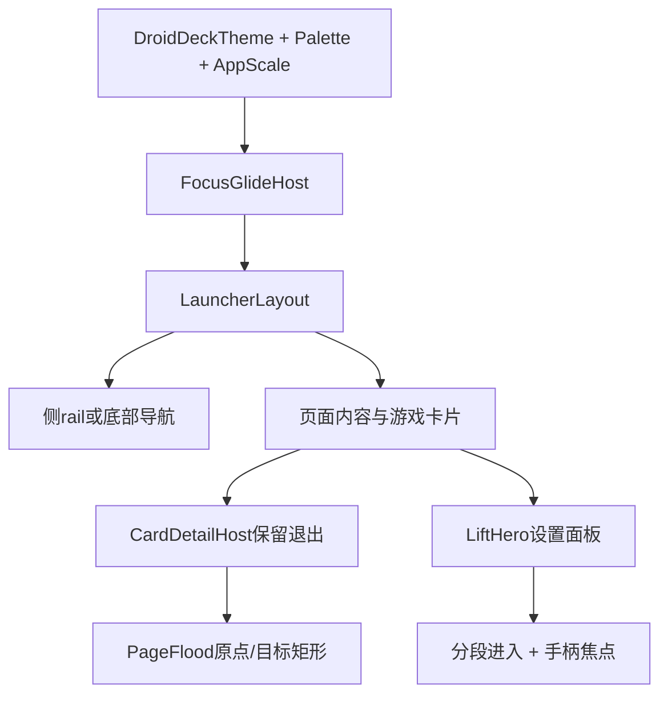

# layout

底栏/侧栏由LauncherLayout(bottomNavigation)的调用方选择；isNarrowScreen<600用于若干紧凑内容和rail标签，不能说所有600dp窗口自动改成同一种导航。FrontEndScreen调用时dualScreen会禁用bottomNavigation；appScale改变用于判断的Configuration，双屏策略还需独立实机验证。

CardDetailHost把grid留在下面，detail打开时grid降至.95并淡出，关闭保留900ms×Motion.scale。它不是Android通用SharedTransitionLayout，而是记录卡片原点、手绘过渡层和内容树协作。

## 来源与状态

source-verified：上面明确的实现事实。标为“分析”的解释为 inferred；未运行原项目。

- [`app/src/main/java/com/droiddeck/launcher/ui/Layout.kt:23` — `internal fun LauncherLayout`](https://github.com/Droid-Deck/DroidDeck/blob/f65e7a3d436bee56f32626dc3536708d12e43162/app/src/main/java/com/droiddeck/launcher/ui/Layout.kt#L23)
- [`app/src/main/java/com/droiddeck/launcher/ui/AppScale.kt:8` — `internal fun scaledAppDensity`](https://github.com/Droid-Deck/DroidDeck/blob/f65e7a3d436bee56f32626dc3536708d12e43162/app/src/main/java/com/droiddeck/launcher/ui/AppScale.kt#L8)
- [`app/src/main/java/com/droiddeck/launcher/ui/CardDetailHost.kt:60` — `internal fun CardDetailHost`](https://github.com/Droid-Deck/DroidDeck/blob/f65e7a3d436bee56f32626dc3536708d12e43162/app/src/main/java/com/droiddeck/launcher/ui/CardDetailHost.kt#L60)
- [`app/src/main/java/com/droiddeck/launcher/ui/PageFlood.kt:80` — `internal fun PageFlood`](https://github.com/Droid-Deck/DroidDeck/blob/f65e7a3d436bee56f32626dc3536708d12e43162/app/src/main/java/com/droiddeck/launcher/ui/PageFlood.kt#L80)
- [`app/src/main/java/com/droiddeck/launcher/ui/Theme.kt:167` — `fun DroidDeckTheme`](https://github.com/Droid-Deck/DroidDeck/blob/f65e7a3d436bee56f32626dc3536708d12e43162/app/src/main/java/com/droiddeck/launcher/ui/Theme.kt#L167)
