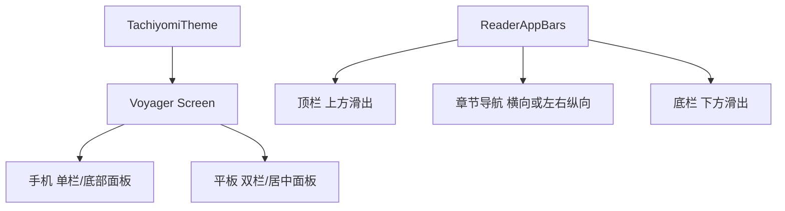

# layout

720dp smallestScreenWidthDp 是平板 UI 门槛，不是浏览器 viewport media query；Configuration 可受项目覆盖策略影响。手机 AdaptiveSheet 底部对齐并可拖，平板居中且最大460dp、不可滑动关闭。TwoPanelBox 只分配两列，不负责自己判断断点。

列表与网格通过 Lazy 组件组织；FastScroller 在 placement 阶段读位置，减少滚动触发整组重组。尺寸旋转、极大字体与边到边 Insets 未实机验证。

## 来源与状态

source-verified：上面明确的实现事实。标为“分析”的解释为 inferred；未运行原项目。

- [`app/src/main/java/eu/kanade/tachiyomi/util/system/DisplayExtensions.kt:11` — `TABLET_UI_REQUIRED_SCREEN_WIDTH_DP`](https://github.com/mihonapp/mihon/blob/4823ba69ca65fa707fb89406f3a4c43c9e0053dd/app/src/main/java/eu/kanade/tachiyomi/util/system/DisplayExtensions.kt#L11)
- [`presentation-core/src/main/java/tachiyomi/presentation/core/components/AdaptiveSheet.kt:53` — `fun AdaptiveSheet`](https://github.com/mihonapp/mihon/blob/4823ba69ca65fa707fb89406f3a4c43c9e0053dd/presentation-core/src/main/java/tachiyomi/presentation/core/components/AdaptiveSheet.kt#L53)
- [`presentation-core/src/main/java/tachiyomi/presentation/core/components/TwoPanelBox.kt:19` — `fun TwoPanelBox`](https://github.com/mihonapp/mihon/blob/4823ba69ca65fa707fb89406f3a4c43c9e0053dd/presentation-core/src/main/java/tachiyomi/presentation/core/components/TwoPanelBox.kt#L19)
- [`presentation-core/src/main/java/tachiyomi/presentation/core/components/VerticalFastScroller.kt:189` — `val alpha = remember`](https://github.com/mihonapp/mihon/blob/4823ba69ca65fa707fb89406f3a4c43c9e0053dd/presentation-core/src/main/java/tachiyomi/presentation/core/components/VerticalFastScroller.kt#L189)
- [`app/src/main/java/eu/kanade/presentation/reader/appbars/ReaderAppBars.kt:46` — `fun ReaderAppBars`](https://github.com/mihonapp/mihon/blob/4823ba69ca65fa707fb89406f3a4c43c9e0053dd/app/src/main/java/eu/kanade/presentation/reader/appbars/ReaderAppBars.kt#L46)
